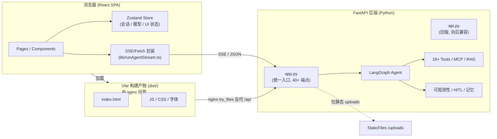
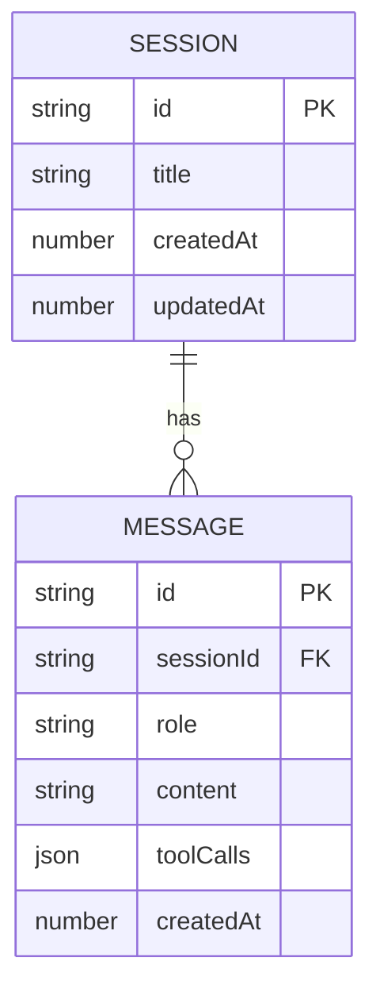

# AI Agent 控制台 - 技术架构文档

## 1. 架构设计

> **最后核对**：2026-10-20（本文所有技术选型与目录结构已与代码逐项比对）。
> 当代码与本文冲突时，**以代码为准**，并按 [CONVENTIONS.md](../../../CONVENTIONS.md) 的证据格式修正本文。

整体为「前后端分离 + 生产同源代理」架构：前端是独立 Vite/React 应用（开发期独立 dev server，生产期构建产物由 **nginx** 托管并反代 `/api`），避免 CORS 与登录态分裂。后端为既有 FastAPI 应用，不做修改。



> **变更说明（2026-10-20 实测修正）**：原图中的 `web_ui.py` **已不存在**，其端点全部合并进
> [`ai_agent/app.py`](file:///e:/langChain_langGraph/ai_agent/app.py#L1-L11)（其模块 docstring 明写「合并 `api.py` 与 `web_ui.py`」）。
> 另：前端产物**不由 FastAPI 托管**，见下文「§8 部署集成」。

## 2. 技术选型

- **前端框架**：React 19 + TypeScript + Vite 5（实测 `react ^19.2.8`、`vite ^5.4.10`）
- **路由**：React Router 6（`react-router-dom ^6.26.2`）
- **状态管理**：Zustand 5（`^5.0.15`）；持久化用 `persist` + `createJSONStorage(() => localStorage)`，**不用 IndexedDB**
- **样式**：Tailwind CSS 3（`^3.4.13`）+ CSS Variables（设计 tokens）
- **组件库**：**无第三方组件库**。`@radix-ui` / `class-variance-authority` 均不在依赖中，`src/components/ui/` 目录**不存在**；UI 为手写 Tailwind + 本地 `cn()` 助手（`src/lib/utils.ts`，clsx 封装）。`globals.css` 保留了 shadcn 风格的兼容 token，但未安装组件本体
- **图标**：`lucide-react`
- **Markdown**：`react-markdown` + `remark-gfm` + `react-syntax-highlighter`（Prism）
- **流式**：**自封装** SSE（`src/lib/sseParser.ts` + `runAgentStream.ts`），未使用 `@microsoft/fetch-event-source`
- **动画**：`framer-motion ^11.11.9`（依赖仍在，但 `vite.config.ts` 注释标注「目前未使用但保留」）
- **图表**：**未使用**。依赖清单中**无** `recharts`
- **HTTP**：**未使用 `ky`**。统一走本地 `src/lib/api.ts`（原生 `fetch` 封装，导出 `api` 对象，base 为 `import.meta.env.VITE_API_BASE ?? '/api'`）
- **包管理器**：**npm**（仓库内有 `package-lock.json`，CI 用 `npm ci`；非 pnpm）
- **后端**：沿用现有 FastAPI，不做改动（仅补 CORS allow-origin 以兼容开发期 5173 端口）
- **数据库**：不引入新数据库（沿用 SQLite 持久化 + localStorage）

> **2026-10-20 实测修正**：原清单中的 `ky`、`recharts`、`@microsoft/fetch-event-source`、`idb-keyval`、
> `react-virtuoso`、`shadcn/ui`、`React 18`、`pnpm` 经 `package.json` 与目录实测**均未使用**。
> 详见 [CONVENTIONS.md §2](../../../CONVENTIONS.md)。

## 3. 目录结构

```
web_console/                      # 独立前端项目（与 ai_agent/ 平级），npm
├── index.html
├── package.json
├── vite.config.ts               # 含 manualChunks 拆包
├── vitest.config.ts             # 单测配置（覆盖率按目录分组设阈值）
├── playwright.config.ts         # E2E（testDir: ./e2e，排除 visual.spec.ts）
├── tailwind.config.js
├── postcss.config.js
├── tsconfig.json                # strict:true，别名 @/* → src/*
├── e2e/                         # Playwright：app / chat-flow / visual
└── src/
    ├── main.tsx
    ├── App.tsx                  # 路由表（/chat、/admin、/insights + 旧链接重定向）
    ├── styles/
    │   └── globals.css          # 设计 token（CSS 变量）唯一来源
    ├── pages/
    │   ├── v2/                  # 当前主页面
    │   │   ├── ChatPage.tsx
    │   │   ├── AdminPage.tsx    # Tab 聚合：agents/tools/settings/approval/memory/prompts
    │   │   └── InsightsPage.tsx # Token 用量 / 错误率 / Trace
    │   ├── Agents.tsx           # 旧页，由 AdminPage 动态 import 复用
    │   ├── Tools.tsx
    │   ├── Settings.tsx
    │   ├── Approval.tsx
    │   ├── Observability.tsx
    │   ├── Memory.tsx
    │   └── Prompts.tsx
    ├── components/
    │   ├── layout/              # AppShell / Sidebar / TopBar / ThemeSync
    │   ├── chat/                # SessionSidebar / AgentConfigModal / ModelChip / Workflow*
    │   ├── v2/                  # ApprovalCard / ResumeDrawer / ToolCallTimeline /
    │   │                        #   TokenUsageWidget / ErrorRateWidget / TraceListTable /
    │   │                        #   AgentExecutionGraph / AttachmentUploader
    │   └── assistant-ui/        # CodeBlock / ThinkingBlock / markdown-text / tool-fallback
    ├── hooks/
    │   ├── useAgentLocalRuntime.ts
    │   └── useAgentThreadListRuntime.ts
    ├── stores/                  # agentStore / chatStore / uiStore / workflowStore /
    │                             #   credentialsStore（均为 useXxxStore）
    ├── lib/                     # api.ts（fetch 封装）/ sseParser.ts / runAgentStream.ts /
    │                             #   agentStreamResume.ts / agentStreamRetry.ts / utils.ts(cn)
    └── types/
        └── api.ts
```

> **2026-10-20 实测修正**：原树中 `router.tsx`、`styles/tokens.css`、`pages/Chat.tsx`、`components/ui/`、
> `hooks/{useChatStream,useEventSource,useAgents}.ts`、`stores/sessionStore.ts`、`lib/{sse,format}.ts`、
> `types/{agent,message}.ts` 以及 `components/{chat/MessageList,agents/AgentCard,approval/PendingItem,observability/*,tools/ToolCard}.tsx`
> 经目录实测**均不存在**；`pages/` 与 `components/` 已按 `chat/`+`v2/`+`assistant-ui/` 重组。
> 逐条存在性证据见 [CONVENTIONS.md §2-§4](../../../CONVENTIONS.md)。

## 4. 路由定义

> 路由表以 [`web_console/src/App.tsx`](file:///e:/langChain_langGraph/web_console/src/App.tsx#L47-L60) 为准（v2.0 slim 骨架）。

| 路由 | 页面 | 说明 |
|------|------|------|
| `/` | → 重定向 `/chat` | — |
| `/chat` | `pages/v2/ChatPage` | 聊天主界面 |
| `/admin` | `pages/v2/AdminPage` | Tab 聚合：`?tab=agents\|tools\|settings\|approval\|memory\|prompts` |
| `/insights` | `pages/v2/InsightsPage` | Token 用量 / 错误率 / Trace 列表 |
| `*` | `NotFound` | 404 页 |

**旧链接兼容重定向**（[App.tsx `CompatRedirects`](file:///e:/langChain_langGraph/web_console/src/App.tsx#L76-L91)）：

| 旧路由 | 重定向到 |
|---|---|
| `/agents` `/tools` `/settings` `/approval` `/prompts` `/memory` | `/admin?tab=<同名>` |
| `/observability` | `/insights` |

> **2026-10-20 实测修正**：原表中 `/`、`/agents`、`/approval`、`/observability`、`/tools`、`/settings`
> 六个独立页面路由已不存在（`Agents.tsx` 等旧页文件保留，但只作为 AdminPage 的 Tab 被动态 import）。
> **已删除**原表中的 `/memory`、`/prompts` 遗漏项——它们同样存在但走 `/admin?tab=`。

## 5. API 对接

所有接口以 `import.meta.env.VITE_API_BASE` 为前缀，**默认 `/api`（同源相对路径，非 `http://localhost:8000`）**
——见 [`web_console/src/lib/api.ts`](file:///e:/langChain_langGraph/web_console/src/lib/api.ts#L13-L14)。开发期由 Vite 代理 `/api` → `http://localhost:8000`（`vite.config.ts` server.proxy）。

```ts
// types/api.ts
export type Role = "user" | "assistant" | "system" | "tool";
export type ToolCallStatus = "pending" | "running" | "success" | "error";

export interface ChatMessage {
  id: string;
  sessionId: string;
  role: Role;
  content: string;
  toolCalls?: ToolCall[];
  createdAt: number;
}

export interface ToolCall {
  id: string;
  name: string;
  args: Record<string, unknown>;
  result?: string;
  status: ToolCallStatus;
  startedAt: number;
  endedAt?: number;
}

export interface Agent {
  id: string;
  name: string;
  status: "idle" | "running" | "error";
  capabilities: string[];
  load: number;
  profile?: Record<string, unknown>;
}

export interface PendingApproval {
  id: string;
  sessionId: string;
  toolName: string;
  reason: string;
  createdAt: number;
}

export interface TraceSpan {
  id: string;
  parentId?: string;
  name: string;
  startedAt: number;
  endedAt?: number;
  attrs?: Record<string, unknown>;
}
```

### 后端接口映射

> **本表已于 2026-10-20 全量重写**：逐条 grep `app.py` / `api.py` 的 `@app.<method>("路径")` 装饰器实测得出。
> 证据：[app.py](file:///e:/langChain_langGraph/ai_agent/app.py)（79 个路由）、
> [api.py](file:///e:/langChain_langGraph/ai_agent/api.py)（27 个路由）。
>
> ⚠️ **原表 12 条中 9 条与代码不符**，逐条对照见下方「修正对照表」。

**前端实际调用的核心接口**（与 `web_console/src/lib/api.ts` 对应）：

| 前端调用 | 方法/路径 | 后端位置 | 状态 |
|---|---|---|---|
| 健康检查 | `GET /api/health` | app.py:996 | ✅ |
| 列出 Agent | `GET /api/agents` | app.py:1689 | ✅ |
| 能力列表 | `GET /api/capabilities` | app.py:1808 | ✅ |
| 实时负载 | `GET /api/load_stats` | app.py:1814 | ✅ |
| 最近事件 | `GET /api/events` | app.py:2692 | ✅ |
| 最近 Trace | `GET /api/traces` | app.py:2699 | ✅ |
| 待审批（HITL） | `GET /api/hitl/pending` | app.py:1944 | ✅ |
| 提交审批 | `POST /api/hitl/decide` | app.py:1958 | ✅ |
| 设置 API Key | `POST /api/api-key` | app.py:1581 | ⚠️ 路径已变（原 `POST /set_api_key`） |
| 切换模型 | `POST /api/model/switch` | app.py:1593 | ⚠️ 路径已变（原 `POST /switch_model`） |
| 普通聊天 | `POST /api/chat` | app.py:1103 | ⚠️ 路径已变（原 `POST /chat`，且在 app.py 而非 api.py） |
| 流式聊天 | `POST /api/chat/stream` | app.py:1114 | ⚠️ 路径已变（原 `/api/chat/stream`→ 实际同路径，但旧表标为 web_ui；另有 WS 版 `WS /api/chat/stream` app.py:1511） |

**补充**：`GET /api/events` 与 `GET /api/traces` 的 `?limit=` 查询参数仍需确认（未在本轮验证签名）。

### 修正对照表（原表 → 实测）

| # | 原文档写的 | 实测 | 判定 |
|---|---|---|---|
| 1 | 流式聊天 `POST /api/chat/stream`（web_ui） | app.py:1114 同路径 + WS 版 1511 | ⚠️ 后端归属错 |
| 2 | 列出 Agent `GET /api/agents`（web_ui） | app.py:1689 同路径 | ⚠️ 后端归属错 |
| 3 | 实时负载 `GET /api/load_stats`（web_ui） | app.py:1814 同路径 | ⚠️ 后端归属错 |
| 4 | 待审批 `GET /api/hitl/pending`（web_ui） | app.py:1944 同路径 | ⚠️ 后端归属错 |
| 5 | 提交审批 `POST /api/hitl/decide`（web_ui） | app.py:1958 同路径 | ⚠️ 后端归属错 |
| 6 | 最近事件 `GET /api/events?limit=100`（web_ui） | app.py:2692 路径符；`limit` 参数未验证 | ⚠️ 后端归属错 |
| 7 | 最近 Trace `GET /api/traces?limit=100`（web_ui） | app.py:2699 路径符；`limit` 参数未验证 | ⚠️ 后端归属错 |
| 8 | 能力列表 `GET /api/capabilities`（web_ui） | app.py:1808 同路径 | ⚠️ 后端归属错 |
| 9 | 健康检查 `GET /api/health`（web_ui） | app.py:996 同路径 | ⚠️ 后端归属错 |
| 10 | 设置 API Key `POST /set_api_key`（api） | **无此路径**；实际 `POST /api/api-key`（app.py:1581 / api.py:345） | ❌ 路径错 |
| 11 | 切换模型 `POST /switch_model`（api） | **无此路径**；实际 `POST /api/model/switch`（app.py:1593 / api.py:363） | ❌ 路径错 |
| 12 | 普通聊天 `POST /chat`（api） | **无此路径**；实际 `POST /api/chat`（app.py:1103 / api.py:109） | ❌ 路径错 |

**结论**：原表把 `web_ui` 当作独立后端（第 1–9 条）已完全不成立——该文件已合并入 `app.py`；
第 10–12 条的路径**全部缺少 `/api` 前缀**，实测 grep `set_api_key` / `switch_model` / `@app.post("/chat")` 在 `ai_agent/` 下均 0 命中。

> **维护提示**：新增/删除后端路由后，请用
> `Select-String -Path ai_agent\app.py -Pattern '@app\.(get|post|put|delete)\(' ` 重新核对本表。
> `web_console/src/lib/api.ts` 是前端侧的对应真相源。

## 6. 数据模型

前端会话数据使用 **localStorage** 持久化（Zustand `persist` + `createJSONStorage`），**未使用 IndexedDB**。
各 store 按用途独立持久化并带 `version` + `migrate`（见 `src/stores/uiStore.ts` L37-L51）。



> **2026-10-20 实测修正**：原文写「IndexedDB（通过 `idb-keyval` 轻量封装）」，
> 但 `package.json` **无 `idb-keyval` 依赖**，store 实际用 `createJSONStorage(() => localStorage)`。

## 7. 设计 Tokens（CSS 变量）

```css
:root {
  --bg-0: #0A0A0B;          /* 深空黑 */
  --bg-1: #111114;          /* 卡片底 */
  --bg-2: #1A1B1E;          /* 悬浮卡 */
  --border: rgba(255, 255, 255, 0.08);
  --fg-0: #ECECEE;
  --fg-1: #A1A1AA;
  --fg-2: #71717A;
  --accent-1: #06B6D4;      /* 青 */
  --accent-2: #3B82F6;      /* 蓝 */
  --accent-grad: linear-gradient(135deg, #06B6D4 0%, #3B82F6 50%, #A855F7 100%);
  --danger: #F43F5E;
  --success: #10B981;
  --warn: #F59E0B;
  --radius-card: 14px;
  --radius-btn: 10px;
}
```

> **2026-10-20 实测修正**：`--radius-card` 实为 **14px**（原写 12px）；
> `--accent-grad` 实为三段渐变 `#06B6D4 → #3B82F6 → #A855F7`（原写两段引用 var()）。
> 证据：[web_console/src/styles/globals.css](file:///e:/langChain_langGraph/web_console/src/styles/globals.css#L5-L23)。
> 另：`globals.css` 还有浅色主题覆盖（`--bg-0: #F8FAFC` 等，L70-L83）与 shadcn 兼容 token，
> 本文只列深色主题主色板。Tailwind 侧通过 `tailwind.config.js` 的 `colors` 字段桥接（`bg0`/`fg0`/`accent1` 等）。

## 8. 部署集成

- `npm run build`（即 `tsc -b && vite build`）生成 `web_console/dist/`
- **前端产物由 nginx 托管，不由 FastAPI 托管**。实测 `ai_agent/app.py` 中唯一的 `StaticFiles` 挂载是
  `/uploads`（[app.py](file:///e:/langChain_langGraph/ai_agent/app.py#L993)），**没有** 指向 `web_console/dist` 的挂载
- SPA fallback 由 nginx 的 `try_files $uri $uri/ /index.html` 处理（[nginx.conf](file:///e:/langChain_langGraph/nginx.conf#L140-L141)）
- nginx 同时反代 `/api/` `/uploads/` `/ws` `/metrics` 到后端（[nginx.conf](file:///e:/langChain_langGraph/nginx.conf#L89-L132)）
- 后端**有意不返回 HTML**：`ai_agent/tests/test_app_spa_fallback.py` 断言未知路径返回 JSON 404 而非 HTML，
  且注释明写「不依赖 `web_console/dist` 存在（backend 与构建产物解耦）」

> **2026-10-20 实测修正**：原文第 2–4 条描述的「由 `api.py` 挂载 `StaticFiles` 提供 `dist/` + SPA fallback +
> `/legacy` 兜底」**均未实现**。当前形态是「nginx 托管前端 + 反代 API」的完全前后端分离部署。

## 9. 风险与权衡

- **风险 1**：SSE POST 在浏览器端需借助 `fetch-event-source` 或自己封装 `ReadableStream`——**已选择自己封装**
  （`src/lib/sseParser.ts` 无状态解析 + `src/lib/runAgentStream.ts` 控制器/重试/指标），未引入该依赖
- **风险 2**：Markdown 大内容渲染性能——使用 `React.memo` + 消息分页。**注：原文提的 `react-virtuoso`
  经 `package.json` 实测并未安装**，虚拟列表方案未落地
- **风险 3**：~~shadcn/ui 组件 Tailwind 版本需匹配~~ → **已不适用**（未使用 shadcn/ui，固定 Tailwind 3 即可）
- **不引入**：Next.js（避免双服务）、国际化（首版仅中英混排）、鉴权（本地工具）

---

## 10. 文档维护约定

- 本文档与 [CONVENTIONS.md](../../../CONVENTIONS.md) 分工：本文管「架构与选型」，后者管「代码风格与校验口径」。
- **每次改动代码后若发现本文与代码不符，按以下顺序处理**：
  1. 先改代码还是先改文档，取决于哪边是错的（代码错 → 改代码；文档旧 → 改本文）；
  2. 改本文时在对应小节追加 `> **YYYY-MM-DD 实测修正**` 引用块，写明**证据文件 + 行号**；
  3. 禁止只写结论不写证据（遵循 [AGENT_RULES.md §3](../../../AGENT_RULES.md) 输出格式）。
- 目录结构类信息以 `docs/DIRECTORY_STRUCTURE.md` 为补充，本文档只列前端 `web_console/` 视角。
